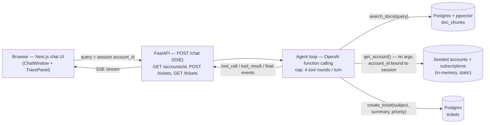

# DeskPilot

AI customer support agent for a fictional SaaS, "Acme Cloud." It answers
product questions from a doc corpus (RAG), looks up account/plan data, and
escalates anything it can't resolve by filing a support ticket — with a chat
UI that shows the full trace (retrieved sources, tool calls, tool results)
alongside the reply.

## Demo

[`docs/demo.mp4`](docs/demo.mp4) — a 74s local walkthrough of three of the
ten locked eval queries, run against the real FastAPI backend, real
Postgres/pgvector, and real OpenAI.

1. **"How do I rotate an API key?"** — answered from the docs, with the
   source doc titles cited in both the reply and the trace panel.
2. **"What plan am I on?"** — calls `get_account` for the session's account
   and answers from the returned plan/seats/renewal data.
3. **"I was charged twice, refund me."** — files a support ticket and echoes
   the ticket id back; the agent never promises the refund itself.

## Architecture



One Postgres database holds both `doc_chunks` (pgvector) and `tickets` — one
less service to explain. Accounts/subscriptions are static seed data, never
written to, so they stay in-memory rather than in Postgres. `get_account`'s
OpenAI function schema takes **zero parameters** — the account id always
comes from the session (`AgentDeps.session_account_id`), never from the
model's arguments or the user's message, which is what makes the account
tool structurally immune to prompt injection (see eval query #10).

## Run it

```bash
cp .env.example .env                 # set OPENAI_API_KEY, DATABASE_URL
docker compose up -d postgres        # local Postgres + pgvector
.venv/bin/python -m deskpilot.ingest # chunk + embed the seed docs
.venv/bin/uvicorn deskpilot.api:app --reload --port 8000

cd frontend
npm install
npm run dev                          # http://localhost:3000, expects the API on :8000
```

Or via Docker (same image CI builds):

```bash
docker build -t deskpilot .
docker run --rm deskpilot                                  # test mode (default): lint + full suite
docker run --rm -p 8000:8080 --env-file .env deskpilot api # api mode
```

## Tests and CI

```bash
.venv/bin/python scripts/test.sh   # backend: lint + format + full suite under coverage
cd frontend && npm test            # frontend: Vitest + React Testing Library
```

`.github/workflows/ci.yml` runs both as independent jobs on every push/PR —
the backend job is literally `docker build` + `docker run --rm deskpilot`,
so CI can't drift from what runs locally. All external APIs (OpenAI,
Postgres) are faked in both suites; nothing in the default gate makes a
network call. See [AGENTS.md](AGENTS.md) for the full test-layer breakdown
and the test-first workflow this repo is built with.

## Eval results

The 10 locked queries (`eval/test_set.py`), graded on tool calls, cited doc
ids, ticket creation, and refusal, against real OpenAI (`gpt-4o-mini`) +
real Postgres (`python -m eval.run_eval`). Two consecutive runs, measured
2026-10-04:

| Run | Passed | Median latency | p95 latency |
|---|---|---|---|
| 1 | 10/10 | 3.47s | 9.83s |
| 2 | 10/10 | 3.27s | 5.04s |

Per-conversation cost isn't reported — it needs token-usage plumbing through
`embed_texts`/`chat_completion` that doesn't exist yet (fast-follow, not
estimated here per the build brief's "don't estimate" rule).

## Limits

- Fictional company and mock backend — this shows the pattern, not a client
  integration.
- The docs corpus is intentionally small (26 short docs, one chunk each);
  no scale claims.
- No auth or multi-tenancy — out of scope for this project, see CloakMotion
  for those.
- Wiring to a real helpdesk (Zendesk, Intercom, HubSpot) is a config and
  integration task on top of this, not something already built.
- No public live demo — shown as a recorded walkthrough and screenshots
  (see "Demo" above) until revenue supports always-on hosting; the AWS
  Terraform deploy (`infra/`) is written but run on demand, not left up.

## Status

Done: seed data + locked eval set, pgvector retrieval, the tool-calling
agent loop, the FastAPI backend (`POST /chat` SSE, accounts, tickets), the
Next.js chat UI with a trace panel, backend/frontend test suites, a
Dockerfile, CI, and this README/diagram/recording.

Not built yet: the AWS Terraform deploy (`infra/`) — deferred, low
priority, not required for the demo since it's shown as a recording rather
than a live link.
